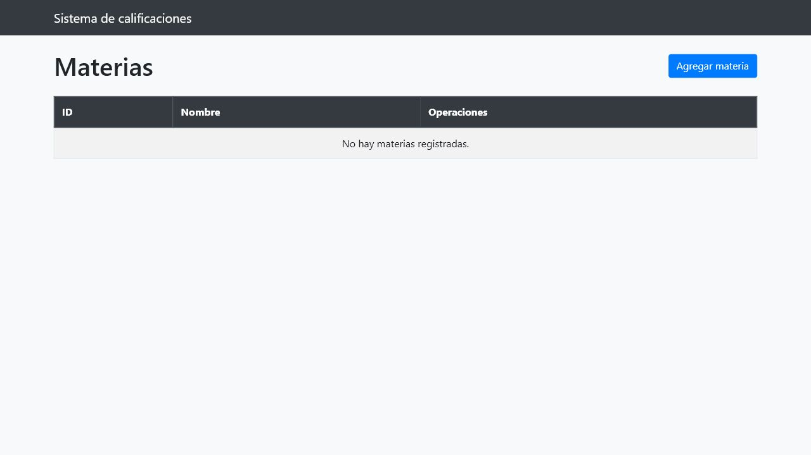
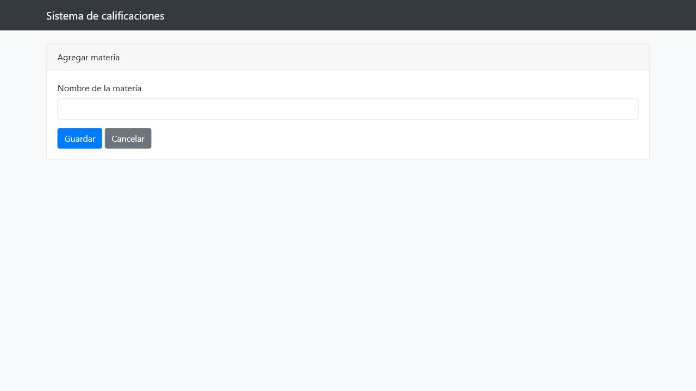
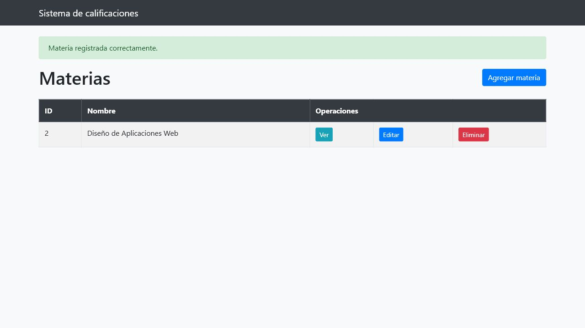
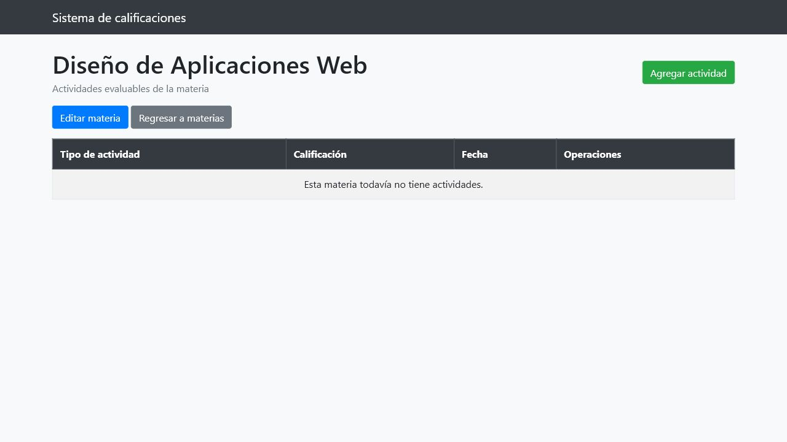
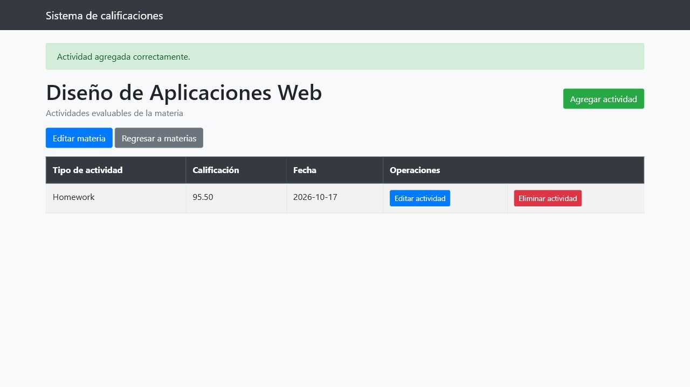
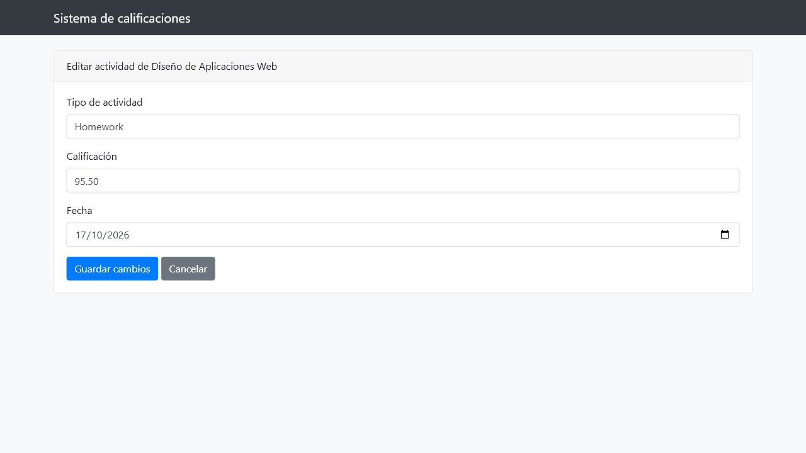
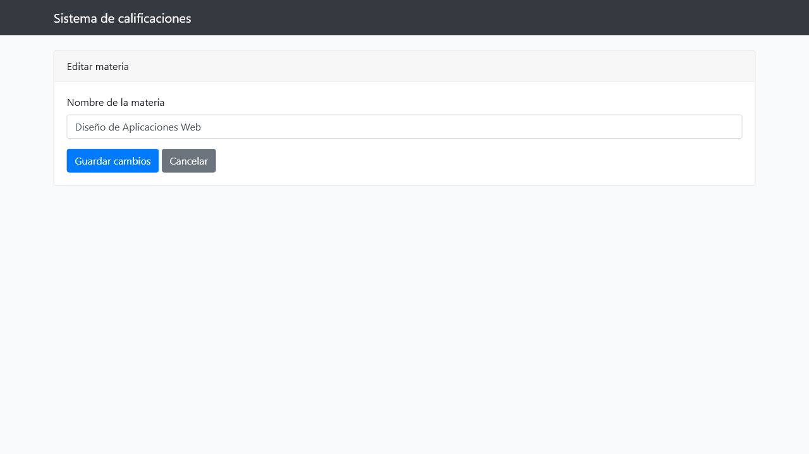
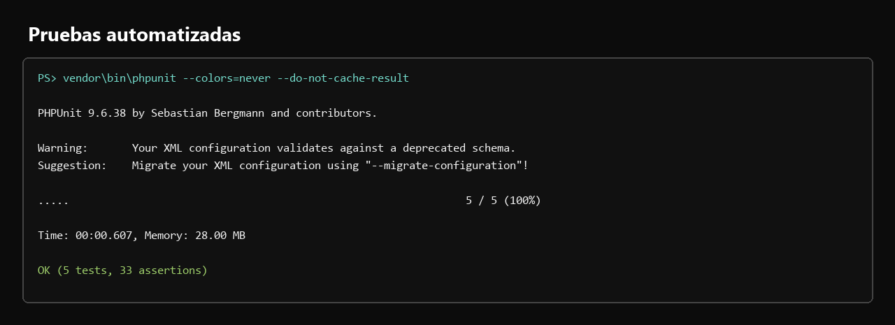
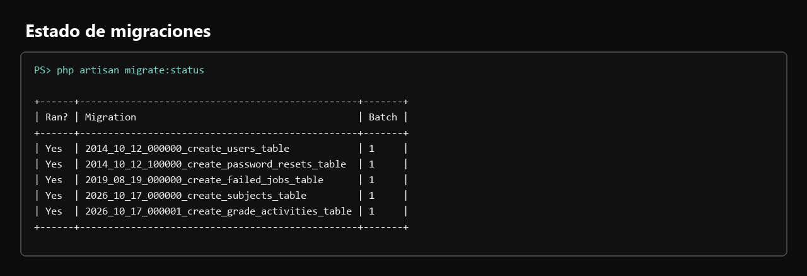
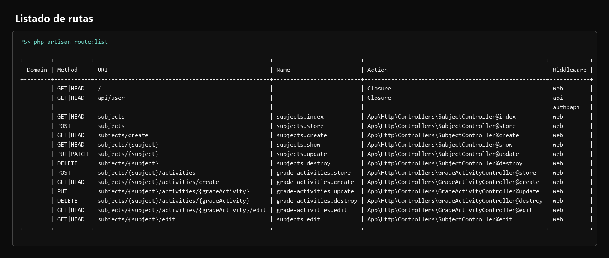

# Actividad 7 - Sistema de calificaciones

## Objetivo

Desarrollar en Laravel 7 un sistema web para administrar materias y sus actividades evaluables, aplicando el patrón MVC, persistencia en una base de datos relacional y operaciones CRUD.

## Requerimientos

1. Crear un proyecto Laravel 7 llamado `grades`.
2. Desarrollar un CRUD para listar las materias.
3. Al seleccionar una materia, mostrar las calificaciones de sus actividades evaluables.
4. Permitir agregar nuevas actividades evaluables indicando tipo, calificación y fecha.
5. Permitir modificar actividades y calificaciones, además de eliminarlas.

## Tecnologías

- Laravel 7.30.7 y Eloquent ORM.
- PHP 7.4.29.
- MySQL/MariaDB.
- Blade para las vistas.
- Bootstrap 4.6.2 para la interfaz.
- PHPUnit 9.6.38 para las pruebas automatizadas.

## Funcionalidades

- Listar materias registradas.
- Crear, consultar, actualizar y eliminar materias.
- Consultar las actividades evaluables de una materia.
- Crear, actualizar y eliminar actividades evaluables.
- Validar nombre, tipo de actividad, calificación y fecha.
- Eliminar en cascada las actividades cuando se elimina su materia.

## Arquitectura MVC

El proyecto separa sus responsabilidades de acuerdo con MVC:

- **Modelos:** `Subject` y `GradeActivity` representan las entidades y su relación en Eloquent.
- **Vistas:** las plantillas Blade de `subjects` y `grade_activities` presentan listados, detalles y formularios.
- **Controladores:** `SubjectController` administra el CRUD de materias y `GradeActivityController` administra las actividades asociadas.
- **Rutas:** `routes/web.php` registra el recurso `subjects` y las rutas anidadas para las actividades evaluables.

## Modelos

### Subject

- Campo asignable: `name`.
- Relación `hasMany`: una materia puede tener muchas actividades evaluables.

### GradeActivity

- Campos asignables: `subject_id`, `type`, `grade` y `date`.
- Conversión de datos: `subject_id` a entero, `grade` a decimal con dos posiciones y `date` a fecha.
- Relación `belongsTo`: cada actividad pertenece a una materia.

## Base de datos

La migración `create_subjects_table` crea:

| Campo | Tipo |
| --- | --- |
| `id` | Identificador entero sin signo |
| `name` | Cadena |
| `created_at`, `updated_at` | Marcas de tiempo |

La migración `create_grade_activities_table` crea:

| Campo | Tipo |
| --- | --- |
| `id` | Identificador entero sin signo |
| `subject_id` | Entero sin signo y llave foránea a `subjects.id` |
| `type` | Cadena |
| `grade` | Decimal `(5,2)` |
| `date` | Fecha |
| `created_at`, `updated_at` | Marcas de tiempo |

La llave foránea usa eliminación en cascada, por lo que las actividades relacionadas se eliminan al borrar su materia.

## CRUD de materias

`SubjectController` implementa los métodos REST de Laravel:

| Método | Operación |
| --- | --- |
| `index` | Lista las materias ordenadas por nombre. |
| `create` | Presenta el formulario de registro. |
| `store` | Valida y guarda una materia. |
| `show` | Muestra una materia y sus actividades ordenadas por fecha e identificador. |
| `edit` | Presenta el formulario de edición. |
| `update` | Valida y actualiza una materia. |
| `destroy` | Elimina una materia. |

La ruta de recurso `Route::resource('subjects', 'SubjectController')` registra las rutas necesarias para estas operaciones.

## Actividades evaluables

`GradeActivityController` implementa `create`, `store`, `edit`, `update` y `destroy`. Las rutas incluyen el identificador de la materia para mantener cada actividad dentro de su contexto. Antes de editar, actualizar o eliminar, el controlador comprueba que la actividad pertenezca a la materia indicada; de lo contrario responde con un error 404.

Los formularios solicitan exactamente:

- Tipo de actividad.
- Calificación numérica.
- Fecha.

## Evidencias

### 1. Lista de materias

La vista inicial muestra el listado y la opción para agregar una materia.

### 2. Formulario para crear una materia

Formulario de registro con el campo de nombre y las acciones para guardar o cancelar.

### 3. Materia creada

Confirmación del registro de `Diseño de Aplicaciones Web` y operaciones disponibles.

### 4. Detalle de la materia

La página de detalle presenta las actividades evaluables relacionadas con la materia.

### 5. Formulario para crear una actividad

Formulario con tipo de actividad, calificación y fecha.

### 6. Actividad registrada

Registro de ejemplo `Homework` con calificación `95.50`, asociado a la materia.

### 7. Formulario para editar una actividad

El formulario recupera los valores actuales antes de guardar cambios.

### 8. Actividad actualizada

Confirmación de la actualización del registro a `Midterm`, con calificación `88.00`.

### 9. Formulario para editar una materia

La edición de materia carga el nombre existente y ofrece las acciones de guardar o cancelar.

### 10. Pruebas automatizadas

Salida real de PHPUnit: 5 pruebas correctas y 33 aserciones, sin fallos.

### 11. Estado de migraciones

Salida real de `php artisan migrate:status`: las cinco migraciones aparecen ejecutadas.

### 12. Rutas de la aplicación

Salida real de `php artisan route:list`, con las rutas de materias y actividades evaluables.

## Pruebas

La verificación automatizada se ejecutó con PHPUnit sobre el proyecto real. El resultado fue:

- 5 pruebas ejecutadas.
- 33 aserciones.
- 0 fallos.

Las pruebas cubren el CRUD de materias, la creación, actualización y eliminación de actividades, la pertenencia de cada actividad a una materia y la eliminación en cascada. Además, se comprobó que `/subjects` responde correctamente, que las cinco migraciones están aplicadas y que las rutas requeridas aparecen registradas.

## Repositorio

[https://github.com/AlejandroVela333/grades](https://github.com/AlejandroVela333/grades)

## Conclusión

El sistema de calificaciones cumple el objetivo de administrar materias y sus actividades evaluables mediante Laravel 7. La implementación conserva una separación MVC clara, valida los datos de entrada, mantiene la integridad de la relación entre entidades y cuenta con evidencias visuales y pruebas automatizadas que confirman su funcionamiento.
